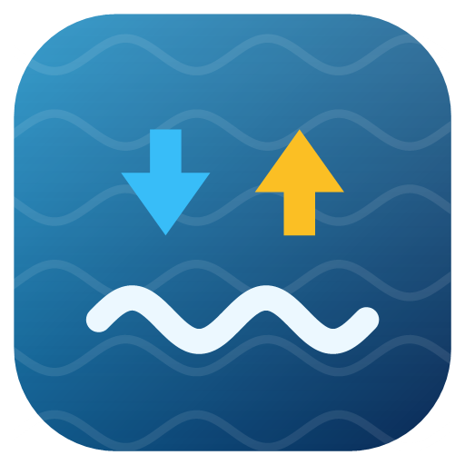
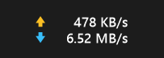
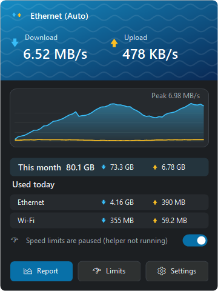
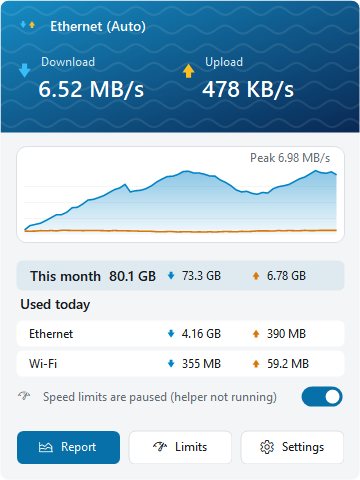
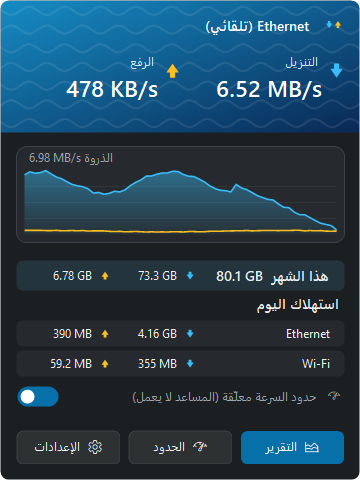
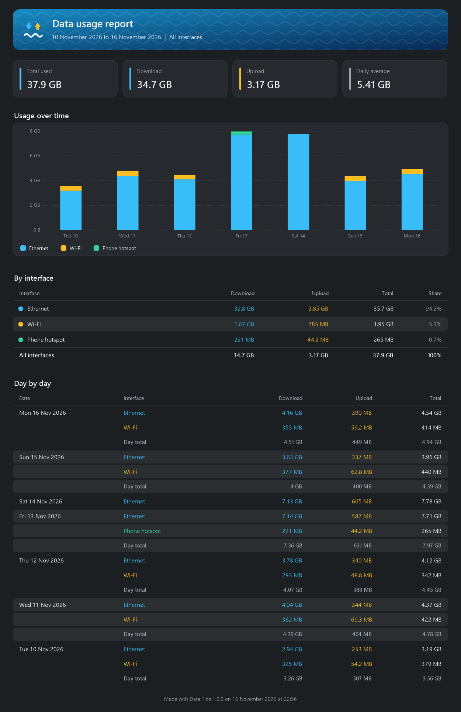
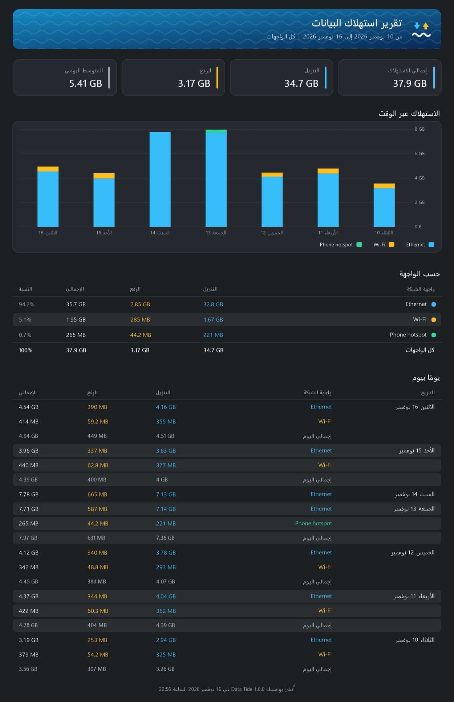
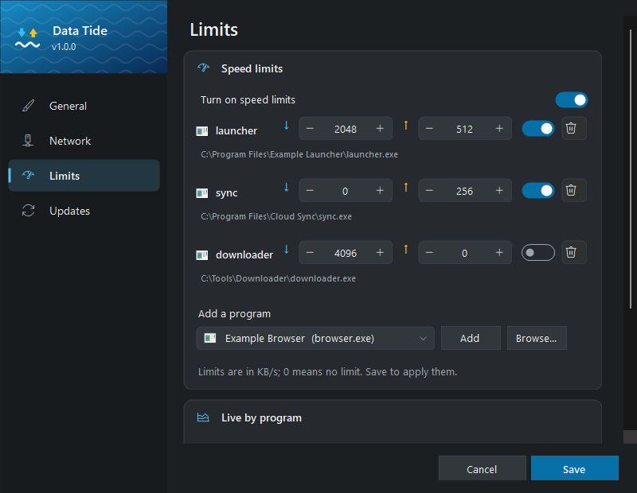
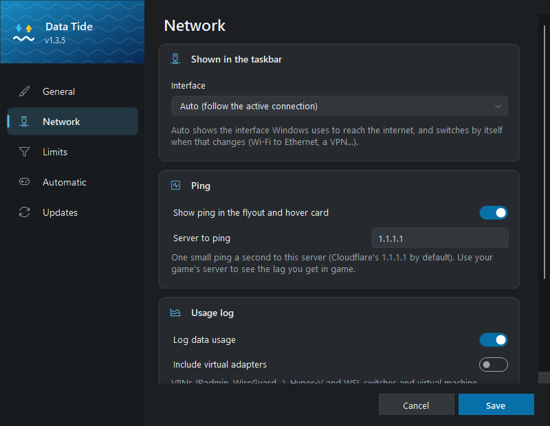

<div align="center">



# Data Tide

**Network speed in your Windows taskbar, a daily data log, and per-app speed limits.**

A small native widget that sits next to the clock and shows live upload and download speed.
It logs how much data every network interface uses each day, turns that into reports you can save
as PNG or PDF, and can cap the download and upload speed of any program. English and Arabic.

[](https://github.com/medovanx/data-tide/releases/latest)
[](https://github.com/medovanx/data-tide/actions/workflows/ci.yml)
[](https://github.com/medovanx/data-tide/releases)
[](LICENSE)


[**Download**](https://github.com/medovanx/data-tide/releases/latest) | [Features](#features) | [Screenshots](#screenshots) | [Speed limits](#speed-limits) | [Privacy](#privacy) | [Build](#build-from-source) | [العربية](#بالعربية)



</div>

---

## Features

- **Lives in the taskbar.** Upload over download, embedded right next to the notification area. It takes the nearest free spot, so it never covers other taskbar tools such as TrafficMonitor or Salaty Reminder, hides with the taskbar in fullscreen apps and comes back after Explorer restarts.
- **Pick the interface.** Auto follows the connection Windows uses to reach the internet (Wi-Fi, Ethernet, a VPN...) and switches by itself, or pin any adapter. Right-click the widget to switch quickly.
- **Monthly usage at a glance.** Rest the mouse on the widget to see today's and this month's data, split into download and upload.
- **Traffic flyout.** Click the widget for big live speeds, a one-minute graph, this month's total and how much each interface used today.
- **Daily data log.** Every interface is logged separately, hour by hour, on your PC. Keep 90 days, about a year, or everything.
- **Reports.** Today, the last 7 or 30 days, this or last month, or all time: totals, a stacked chart with one colour per interface, a table per interface and a day-by-day table. Every number says which interface it belongs to.
- **Export.** Save any report as a crisp PNG or a multi-page A4 PDF, in English or Arabic.
- **Per-app speed limits.** Cap the download and upload speed of any program, for example a game launcher or a cloud sync app, while everything else runs at full speed. See [Speed limits](#speed-limits).
- **English and Arabic.** Full right-to-left layout in Arabic. Light and dark theme follow Windows.
- **Auto-updates.** Checks GitHub Releases, verifies the download's SHA-256 and updates itself in place.
- **Light and native.** One small Windows app, no Electron, no ads, no account.

## Screenshots

<table>
  <tr>
    <td align="center"><br><sub>Traffic flyout</sub></td>
    <td align="center"><br><sub>Light theme</sub></td>
    <td align="center"><br><sub>Arabic, right to left</sub></td>
  </tr>
</table>

<table>
  <tr>
    <td align="center"><br><sub>Usage report</sub></td>
    <td align="center"><br><sub>Report in Arabic</sub></td>
  </tr>
  <tr>
    <td align="center"><br><sub>Per-app speed limits</sub></td>
    <td align="center"><br><sub>Interface and usage log</sub></td>
  </tr>
</table>

A full 30-day report as exported to PNG ([English](docs/screenshots/report-en.png), [Arabic](docs/screenshots/report-ar.png)) and to PDF ([English](docs/sample-report-en.pdf), [Arabic](docs/sample-report-ar.pdf)).
All screenshots use made-up demo data.

## Install

1. Download **`DataTide.exe`** from the [latest release](https://github.com/medovanx/data-tide/releases/latest).
2. Put it somewhere permanent, for example `%LOCALAPPDATA%\Programs\Data Tide\`, and run it.
3. Right-click the widget and turn on **Start with Windows**.

The exe is self-contained, so you don't need to install .NET. Windows SmartScreen may warn on first run because the exe isn't code-signed yet: choose **More info**, then **Run anyway**.

Speed limits need one extra install, described next. Everything else works without it and without administrator rights.

## Speed limits

Windows can't limit a program's **download** speed by itself. Its built-in QoS policies only shape traffic leaving the PC. So Data Tide uses the free **[Windows Packet Filter](https://www.ntkernel.com/windows-packet-filter/)** driver by NT Kernel, a Microsoft-signed network filter driver that many VPN and firewall tools rely on.

1. In **Settings > Limits**, click **Install the driver**. Data Tide downloads the official installer from [NT Kernel's GitHub release](https://github.com/wiresock/ndisapi/releases/latest), checks it against the SHA-256 GitHub publishes, and runs it; Windows asks for administrator rights. The driver isn't bundled: it is free for personal, non-commercial use, and redistributing it needs NT Kernel's permission.
2. In Data Tide, open **Settings > Limits**, add programs from the list of running apps or with **Browse...**, and set download and upload caps in KB/s (0 means no cap).
3. Turn on **speed limits** and save. Windows asks once for administrator rights for the limiter helper.

How it works: only while limits are on, a small helper (the same exe, started with `--limiter`) puts the network adapters in the driver's tunnel mode. It reads each packet, finds the program that owns the connection from the Windows connection tables, and lets it through, holds it briefly, or drops it once the program's queue is full. TCP slows down in response, which is what caps downloads. Packets of programs without a limit go straight back. When you turn limits off, quit, or the app closes, the helper restores the adapters and exits.

Notes:

- Anti-cheat software in some games may not like any packet filter driver while it is active. Turn limits off before playing such games, or uninstall the driver if one refuses to start.
- Limits are per program file, so every running copy of that exe shares one cap.

## Usage

| Action | What happens |
| --- | --- |
| Hover over the widget | Today's and this month's usage |
| Click the widget | Opens the traffic flyout; its switch turns speed limits on or off |
| Right-click the widget | Menu: traffic, usage report, speed limits, interface, settings, updates, start with Windows, exit |
| Report window | Pick a range and an interface, then **Save PNG** or **Save PDF** |
| Launch the exe again | Opens the flyout of the running instance |

## Settings

| Page | Options |
| --- | --- |
| General | Language (English, Arabic), bytes or bits, widget position (beside the tray or on the left) and shift in pixels, start with Windows |
| Network | Interface shown in the widget (Auto or a specific adapter), log usage, history length, open the data folder, clear history |
| Limits | Turn limits on or off, programs with their download and upload caps, live speed per program, driver status |
| Updates | Check automatically, install automatically, check now |

Settings are stored in `%APPDATA%\DataTide\settings.json` and the usage log in `%APPDATA%\DataTide\usage.csv`
(one row per hour and interface: `hour,interface_id,interface_name,received,sent`). You can open the CSV in Excel.

## Privacy

Data Tide has no account, analytics or tracking. Your usage log never leaves your PC.

| Service | When | What it sends |
| --- | --- | --- |
| [GitHub API](https://docs.github.com/rest/releases) | Update checks, and finding the driver installer when you click Install | Nothing besides the request |
| [GitHub Releases of wiresock/ndisapi](https://github.com/wiresock/ndisapi/releases) | Only when you click **Install the driver** | Nothing besides the download |

Turn off update checks for a fully offline app. To find the "Auto" interface Data Tide asks the Windows routing table which adapter would reach `1.1.1.1`; no packet is sent there. Speed limits read packet headers on your PC only to find which program a packet belongs to; nothing is stored or sent.

## How it works

- **The widget** is a per-pixel-alpha child window inside `Shell_TrayWnd`, the same technique TrafficMonitor uses. It places itself at the nearest spot left of the notification area that overlaps no other app's window there, so several such widgets settle side by side instead of pushing each other along. It recreates itself when Explorer restarts (`TaskbarCreated`) and finds the real tray edge through UI Automation when Windows reports it wrongly after boot.
- **Speeds and usage** come from each adapter's 64-bit byte counters, read once a second. The first reading of an adapter only sets a baseline, a counter that goes backwards (adapter reset, sleep) counts from zero, and impossible jumps are ignored.
- **Reports** are drawn with GDI+, so Arabic is shaped and laid out right to left. PDFs are written without any outside library: each A4 page is a lossless image, and tables continued on a new page repeat their header.
- **Updates** come from GitHub Releases tagged `vMAJOR.MINOR.PATCH`. The new exe is downloaded next to the running one and checked against the SHA-256 digest GitHub publishes. The running exe is then renamed to `.old`, the new one takes its place and restarts.

## Project structure

```text
data-tide/
├── src/
│   ├── DataTide.Core/            Logic with no Windows or UI dependencies
│   │   ├── Formatting/           Sizes and speeds
│   │   ├── Limiting/             Token bucket, shaper, packet parser, limit rules
│   │   └── Usage/                Counter deltas, hourly ledger, CSV, reports
│   └── DataTide/                 The Windows app
│       ├── Assets/               Icon
│       ├── Configuration/        Settings and start-with-Windows
│       ├── DevTools/             --shots, --render-icon and demo data
│       ├── Interop/              Win32, DWM and theme calls
│       ├── Limiting/             Packet filter driver, process lookup, elevated helper
│       ├── Localization/         English and Arabic text and dates
│       ├── Reports/              Report layout, PNG and PDF export
│       ├── Services/             Network counters, usage store, updater, log
│       └── UI/
│           ├── Controls/         Themed toggle, dropdown, number box, buttons
│           ├── Flyout/           The traffic popup
│           ├── Report/           The report window
│           ├── Settings/         The settings window
│           ├── Styling/          Theme colours and drawing helpers
│           └── Taskbar/          The widget inside the taskbar
├── tests/
│   └── DataTide.Core.Tests/      xUnit tests
├── docs/                         README images
├── Directory.Build.props         Version and settings shared by every project
├── global.json                   Pinned .NET SDK
└── DataTide.slnx
```

## Build from source

Requirements: Windows 10 or 11 and the [.NET 10 SDK](https://dotnet.microsoft.com/download).

```bash
git clone https://github.com/medovanx/data-tide.git
cd data-tide
dotnet build
dotnet test
dotnet run --project src/DataTide -c Release
```

Build the single-file release exe:

```bash
dotnet publish src/DataTide/DataTide.csproj -c Release -r win-x64 --self-contained -p:PublishSingleFile=true -p:IncludeNativeLibrariesForSelfExtract=true -p:EnableCompressionInSingleFile=true -o publish
```

Developer switches:

| Switch | Purpose |
| --- | --- |
| `--shots DIR` | Render the widget, flyout, settings, reports and sample PDFs from demo data |
| `--render-icon DIR` | Regenerate `app.ico` and a 512 px PNG |
| `--limiter PID PIPE` | The elevated limiter helper (started by the app, not by hand) |

## Releasing

Versions follow [Semantic Versioning](https://semver.org/). Bump `<Version>` in `Directory.Build.props`, add the changes to [CHANGELOG.md](CHANGELOG.md), then tag and push:

```bash
git tag v1.1.0
git push origin v1.1.0
```

The [release workflow](.github/workflows/release.yml) runs the tests, builds the exe and publishes a GitHub Release, which running copies pick up automatically.

## Credits

- Speed limits: [Windows Packet Filter](https://www.ntkernel.com/windows-packet-filter/) by NT Kernel Resources, installed separately under its own license.
- Icons: Segoe Fluent Icons by Microsoft, built into Windows.

## License

[MIT](LICENSE).

---

<div dir="rtl">

## بالعربية

**داتا تايد** أداة صغيرة تظهر في شريط المهام بجوار الساعة، تعرض سرعة الرفع والتنزيل لحظة بلحظة، وتسجل استهلاك البيانات لكل واجهة شبكة يومًا بيوم.

- اختيار واجهة الشبكة أو الوضع التلقائي الذي يتبع الاتصال النشط
- سجل يومي لاستهلاك كل واجهة على حدة، محفوظ على جهازك فقط
- تقارير بالرسوم والجداول يمكن حفظها كصورة PNG أو ملف PDF
- تحديد سرعة التنزيل والرفع لكل برنامج (يتطلب برنامج التشغيل المجاني Windows Packet Filter)
- واجهة عربية كاملة من اليمين إلى اليسار، ووضع داكن وفاتح يتبع ويندوز
- تحديث تلقائي آمن من GitHub

**التثبيت:** حمّل `DataTide.exe` من [آخر إصدار](https://github.com/medovanx/data-tide/releases/latest) وشغّله، ثم فعّل "التشغيل مع ويندوز" من قائمة الزر الأيمن على الأداة.

</div>
